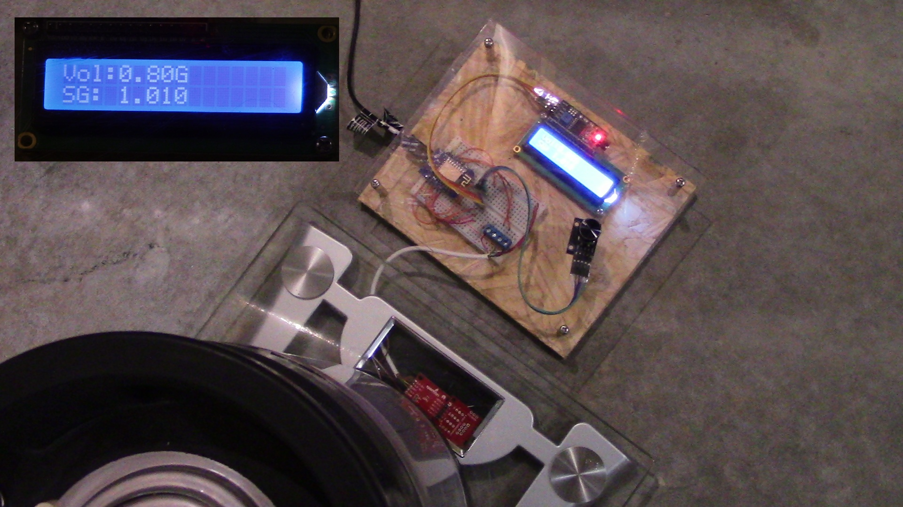

Source files for the Brewski Tech Fridge Monitor project

See the full project documentation at https://makerhub.site/docs/brewskitech/keg-fill-station

## Files

KegFillStation.yaml - HomeAssistant ESPHome configuration file

KegFillStation.fzz - Fritzing file for electronics

KegFillStation_bb.png - snapshot of breadboard layout

KegFillStation_schem.png - snapshot of schematic layout
